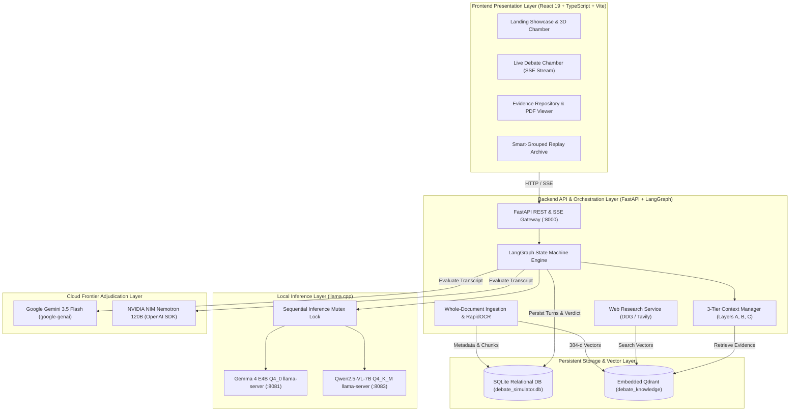

# AI DEBATE SIMULATOR | Architecture, LLM Quantization, llama.cpp & Performance Benchmarks

> **"Don't Ask One AI. Make AI Debate."**
>
> An evidence-grounded, multi-agent dialectical research platform where two specialized local LLMs debate opposing propositions using verified documentary evidence, adjudicated by an independent remote AI Judge.

---

## Table of Contents

- [1. Project Overview](#1-project-overview)
  - [The Problem with Single-LLM Chatbots](#the-problem-with-single-llm-chatbots)
  - [Dialectical Multi-Agent Debate](#dialectical-multi-agent-debate)
  - [End-to-End System Workflow](#end-to-end-system-workflow)
  - [Verified Modalities & Implementation Status](#verified-modalities--implementation-status)
- [2. Core Features](#2-core-features)
- [3. System Architecture](#3-system-architecture)
  - [Architectural Layers](#architectural-layers)
  - [End-to-End Architecture Diagram](#end-to-end-architecture-diagram)
  - [Component Responsibilities](#component-responsibilities)
- [4. AI Models in the Architecture](#4-ai-models-in-the-architecture)
  - [PRO Agent: Google Gemma 4 E4B Instruct](#pro-agent-google-gemma-4-e4b-instruct)
  - [CON Agent: Alibaba Qwen2.5-VL-7B-Instruct](#con-agent-alibaba-qwen25-vl-7b-instruct)
  - [Judge Agent: Google Gemini 3.5 Flash & NVIDIA Nemotron 120B](#judge-agent-google-gemini-35-flash--nvidia-nemotron-120b)
- [5. What is Quantization?](#5-what-is-quantization)
  - [Parameters, Weights, and Numerical Precision](#parameters-weights-and-numerical-precision)
  - [Precision Spectrum: FP32 to INT4](#precision-spectrum-fp32-to-int4)
  - [Storage and RAM Impact on a 7B Parameter Model](#storage-and-ram-impact-on-a-7b-parameter-model)
  - [Impact on CPU Inference & Memory Bandwidth](#impact-on-cpu-inference--memory-bandwidth)
  - [Quantization Trade-offs: Quality, Memory, and Latency](#quantization-trade-offs-quality-memory-and-latency)
- [6. How We Quantized Our Models](#6-how-we-quantized-our-models)
  - [Gemma 4 E4B Quantization Workflow (Q4_0 GGUF)](#gemma-4-e4b-quantization-workflow-q4_0-gguf)
  - [Qwen2.5-VL-7B Quantization Workflow (Q4_K_M GGUF & Projector)](#qwen25-vl-7b-quantization-workflow-q4_k_m-gguf--projector)
  - [Weights vs. GGUF vs. Multimodal Projector vs. Tokenizers](#weights-vs-gguf-vs-multimodal-projector-vs-tokenizers)
- [7. What is llama.cpp?](#7-what-is-llamacpp)
  - [Core Principles & GGUF Format](#core-principles--gguf-format)
  - [llama-server & OpenAI-Compatible REST API](#llama-server--openai-compatible-rest-api)
  - [Why llama.cpp Over PyTorch, BitsAndBytes, or Ollama](#why-llamacpp-over-pytorch-bitsandbytes-or-ollama)
- [8. Hardware Profile & Local Inference Strategy](#8-hardware-profile--local-inference-strategy)
  - [Host Hardware Profile](#host-hardware-profile)
  - [The Sequential Dual-Server Inference Lock](#the-sequential-dual-server-inference-lock)
- [9. Model Inference Configuration](#9-model-inference-configuration)
  - [llama-server Runtime Parameters](#llama-server-runtime-parameters)
  - [Sanitized Environment Configuration (`.env.example`)](#sanitized-environment-configuration-envexample)
- [10. Performance Optimization & Benchmarks](#10-performance-optimization--benchmarks)
  - [Generation Throughput Acceleration](#generation-throughput-acceleration)
  - [Prompt Prefill Latency Optimization (TTFT)](#prompt-prefill-latency-optimization-ttft)
  - [Token Ceiling & Recovery Optimization](#token-ceiling--recovery-optimization)
  - [KV Cache & Context Window Tuning](#kv-cache--context-window-tuning)
  - [In-Memory Embedding LRU Cache](#in-memory-embedding-lru-cache)
  - [Server-Sent Events (SSE) Real-Time Token Streaming](#server-sent-events-sse-real-time-token-streaming)
- [11. Actual Measured End-to-End Benchmark Results](#11-actual-measured-end-to-end-benchmark-results)
  - [Cold-Start Benchmark Breakdown (186.47s)](#cold-start-benchmark-breakdown-18647s)
  - [Warm-Start Benchmark Breakdown (138.24s)](#warm-start-benchmark-breakdown-13824s)
  - [Multi-Round Benchmark Matrix (1, 2, 3, and 5 Rounds)](#multi-round-benchmark-matrix-1-2-3-and-5-rounds)
- [12. Whole-Document Understanding & Knowledge Reuse](#12-whole-document-understanding--knowledge-reuse)
  - [Why Zero-Reprocessing Matters](#why-zero-reprocessing-matters)
  - [Canonical Representation vs. Ad-Hoc Ingestion](#canonical-representation-vs-ad-hoc-ingestion)
- [13. Independent AI Judge Evaluation](#13-independent-ai-judge-evaluation)
  - [5-Criterion Weighted Rubric (100 Points Maximum)](#5-criterion-weighted-rubric-100-points-maximum)
  - [Decisive Reasons, Margin Thresholds & Draws](#decisive-reasons-margin-thresholds--draws)
  - [Citation Auditing & Strict Non-Fabrication Policy](#citation-auditing--strict-non-fabrication-policy)
- [14. Installation & Setup Guide](#14-installation--setup-guide)
  - [Prerequisites](#prerequisites)
  - [Backend Setup](#backend-setup)
  - [Frontend Setup](#frontend-setup)
  - [Model Files & Server Startup](#model-files--server-startup)
  - [Running Automated Tests](#running-automated-tests)
- [15. API Documentation](#15-api-documentation)
- [16. Implementation Status & Future Roadmap](#16-implementation-status--future-roadmap)
- [17. Limitations & Operational Boundaries](#17-limitations--operational-boundaries)
- [18. Contributing & License](#18-contributing--license)

---

## 1. Project Overview

### The Problem with Single-LLM Chatbots

Standard conversational generative AI systems suffer from inherent structural challenges when applied to academic research, policy analysis, and rigorous fact-checking:

1. **Confirmation Bias & Agreeableness:** Conversational LLMs are optimized via reinforcement learning from human feedback (RLHF) to be polite, agreeable, and cooperative. When presented with a flawed or ungrounded proposition, they frequently validate and elaborate on the user's premise rather than critically evaluating it.
2. **Rhetorical Hallucination:** Single-pass models often generate convincing yet fabricated citations, non-existent statistical data, or misattributed empirical findings to justify an asserted stance.
3. **Consensus Smoothing:** Without adversarial pressure, single LLMs produce homogenized, middle-of-the-road answers that obscure critical trade-offs, methodological flaws, and opposing empirical literature.

### Dialectical Multi-Agent Debate

The **AI Debate Simulator** departs from standard chat interfaces by implementing a classical **Hegelian dialectic** framework:

$$\text{Thesis (PRO Agent)} \iff \text{Antithesis (CON Agent)} \implies \text{Synthesis (Independent Judge)}$$

- **The PRO Agent (Affirmative):** Defends the proposition. It extracts quantitative benchmarks, theoretical frameworks, and verifiable findings from the ingested document to construct a grounded affirmative case.
- **The CON Agent (Opposition):** Cross-examines the affirmative stance. It attacks unstated assumptions, highlights architectural or practical constraints, challenges over-extrapolations, and cites contrary evidence.
- **The Independent AI Judge (Adjudicator):** An external, unaligned frontier model evaluates both sides across an objective 5-criterion rubric, verifying citations against the retrieved context repository, penalizing unsupported claims, and delivering an impartial verdict or draw.

### End-to-End System Workflow

```
[Document Ingestion / Proposition Selection]
                    │
                    ▼
[Text Extraction, Normalization & OCR] ───► (pypdf + pypdfium2 + RapidOCR)
                    │
                    ▼
[Whole-Document Knowledge Indexing]   ───► (Persisted to SQLite metadata_json)
                    │
                    ▼
[Vector Embedding & Storage]          ───► (sentence-transformers MiniLM-L6-v2 ──► Qdrant)
                    │
                    ▼
[LangGraph Orchestration State Machine]
  │
  ├───► Round 1..N: PRO Turn  ───► (Gemma 4 E4B Q4_0 GGUF @ :8081 via llama.cpp)
  │          └── Scoped Qdrant Retrieval + Grounded Citations [p. X]
  │
  ├───► Round 1..N: CON Turn  ───► (Qwen2.5-VL-7B Q4_K_M GGUF @ :8083 via llama.cpp)
  │          └── Direct Clash Counterarguments + Scoped Evidence
  │
  └───► Adjudication Node     ───► (Google Gemini 3.5 Flash / NVIDIA NIM Nemotron)
             └── Cross-examines arguments vs. Evidence Repository
                    │
                    ▼
[Final Synthesis & Zero-Model History Archival]
```

### Verified Modalities & Implementation Status

| Modality / Workflow | Implementation Status | Evidence / Verification |
|---|---|---|
| **Document-Grounded Debate (PDF)** | **Production / Verified** | 15-page Attention research paper ingested, 13 sections indexed, verified citations. |
| **Topic-First Web Research Debate** | **Production / Verified** | Live DuckDuckGo & Tavily search, chunk deduplication, Qdrant indexing, and debate grounding. |
| **Multi-Round Orchestration (1, 2, 3, 5)** | **Production / Verified** | LangGraph cyclical state machine with persistent turn-by-turn memory and state checkpointing. |
| **Real-Time Token Streaming (SSE)** | **Production / Verified** | Server-Sent Events deliver live tokens from `llama-server` directly to the React UI. |
| **Smart-Grouped Debate History** | **Production / Verified** | Zero-LLM instant replay grouped by proposition; completed runs separated from cancelled runs. |
| **Persistent Execution & Cancellation** | **Production / Verified** | Debates persist across page navigation; explicit cancellation preserves history without deletion. |
| **Visual Evidence Extraction (OCR/Images)** | **Verified Extractor / UI Ready** | RapidOCR + layout extraction in `image_extractor.py`; direct visual clash in model loop is experimental. |
| **Cross-Document Multi-Paper Synthesis** | **Planned Future Feature** | Multi-document collection comparison planned for Phase 3 roadmap. |
| **Multilingual Debate (Telugu/Hindi)** | **Planned Future Feature** | Prompt templates currently calibrated for English academic/technical debate. |

---

## 2. Core Features

- **Document Ingestion & Sectional Chunking:** Ingests research papers, legal statutes, and technical specifications via `pypdf` and `pypdfium2`. Preserves exact page numbers, chapter headers, and table captions.
- **Embedded RapidOCR Engine:** Automatic fallback to RapidOCR for scanned documents, architectural charts, and image-based PDFs.
- **Whole-Document Knowledge Representation:** Extracts high-level summaries, core claims, empirical findings, and auto-suggested debate propositions on upload, cached in SQLite `metadata_json`.
- **Dual Local Inference Engine:** Powered by `llama.cpp` using CPU-optimized GGUF models running as separate HTTP server processes with zero PyTorch or CUDA runtime overhead.
- **Sequential Dual-Server Inference Lock:** Eliminates thread contention on hybrid CPU architectures (Intel P-cores/E-cores) and keeps total RAM usage comfortably under 8 GB.
- **Impartial Multi-Criterion Adjudication:** Adjudicated by Google Gemini 3.5 Flash or NVIDIA Nemotron 120B using a strict 100-point rubric with citation verification.
- **Real-Time SSE Streaming:** Live token-by-token streaming with speech markers, evidence tags, and execution status indicators (`REAL_LOCAL_MODEL` / `REAL_REMOTE_API`).
- **Persistent Execution Lifecycle:** Debates continue executing in the backend independent of browser tabs, page refreshes, or network reconnects.
- **Zero-LLM Replay Archive:** Read-only historical replay reads directly from SQLite, rendering speech timelines, evidence citations, and judicial verdicts with zero model loading.

---

## 3. System Architecture

### Architectural Layers



---

## 4. AI Models in the Architecture

### PRO Agent: Google Gemma 4 E4B Instruct
- **Model Identity:** Google Gemma 4 E4B Instruct (`gemma-4-E4B_q4_0-it.gguf`)
- **Format:** Q4_0 GGUF (4-bit uniform quantization)
- **Engine:** Dedicated `llama-server` process on `http://127.0.0.1:8081`
- **Role:** Affirmative advocate defending the proposition using empirical citations from the document repository.
- **Runtime Footprint:** ~2.49 GB model file, ~3.8 GB RAM resident during inference.

### CON Agent: Alibaba Qwen2.5-VL-7B-Instruct
- **Model Identity:** Alibaba Qwen2.5-VL-7B-Instruct (`Qwen2.5-VL-7B-Instruct-Q4_K_M.gguf`)
- **Format:** Q4_K_M GGUF (medium k-quantization)
- **Vision Projector:** `mmproj-Qwen2.5-VL-7B-Instruct-Q8_0.gguf` (~843 MB, 8-bit precision)
- **Engine:** Dedicated `llama-server` process on `http://127.0.0.1:8083`
- **Role:** Opposition advocate attacking affirmative assumptions, highlighting computational or operational bottlenecks, and citing contrary evidence.
- **Runtime Footprint:** ~4.68 GB model file, ~5.6 GB RAM resident during inference.

### Judge Agent: Google Gemini 3.5 Flash & NVIDIA Nemotron 120B
- **Primary Provider:** Google Gemini 3.5 Flash via official `google-genai` SDK (`gemini-3.5-flash`).
- **Secondary Provider:** NVIDIA Nemotron 120B (`nvidia/nemotron-3.5-super-vl-120b-a12b`) via NVIDIA NIM OpenAI-compatible API.
- **Role:** Objective adjudicator scoring debate turns on a 100-point rubric, checking citations, and rendering the final synthesis verdict.

---

## 5. What is Quantization?

### Parameters, Weights, and Numerical Precision

Large Language Models consist of billions of numerical parameters (weights) organized into transformer layers. In original training configurations, each weight is stored as a 32-bit single-precision float (**FP32**) or a 16-bit half-precision float (**FP16 / BF16**).

- **FP32 (32-bit):** 1 sign bit, 8 exponent bits, 23 mantissa bits = 4 bytes per parameter.
- **FP16 (16-bit):** 1 sign bit, 5 exponent bits, 10 mantissa bits = 2 bytes per parameter.
- **BF16 (16-bit):** 1 sign bit, 8 exponent bits, 7 mantissa bits = 2 bytes per parameter.
- **INT8 (8-bit):** Quantized integer representation = 1 byte per parameter.
- **INT4 (4-bit):** Quantized integer representation = 0.5 bytes per parameter.

### Storage and RAM Impact on a 7B Parameter Model

| Precision Format | Bits per Weight | Theoretical Weight Size | Real GGUF Size (approx.) | Minimum RAM Required | CPU Inference Feasibility |
|---|---:|---:|---:|---:|---|
| **FP32** | 32 bits | 28.00 GB | ~29.50 GB | 36.0 GB | Unusable on 16 GB host (OOM crash) |
| **FP16 / BF16** | 16 bits | 14.00 GB | ~14.80 GB | 18.0 GB | Heavy paging / severe OS swap thrashing |
| **INT8 (Q8_0)** | 8 bits | 7.00 GB | ~7.70 GB | 10.5 GB | High RAM pressure when two models load |
| **INT4 (Q4_K_M)** | ~4.5 bits | ~3.90 GB | **4.68 GB** | **6.2 GB** | **Fast, stable CPU inference** |
| **INT4 (Q4_0)** | 4.0 bits | 3.50 GB | **2.49 GB** *(4B model)* | **3.8 GB** | **Optimal AVX2 CPU throughput** |

### Impact on CPU Inference & Memory Bandwidth

Autoregressive token generation in LLMs is **memory bandwidth bound**, not compute bound. For each generated token, the CPU must stream the model's entire weight matrix from RAM into CPU caches:

$$\text{Maximum Tokens/Sec} \approx \frac{\text{RAM Bandwidth (GB/s)}}{\text{Model Size (GB)}}$$

On a dual-channel DDR5 platform with ~60 GB/s bandwidth:
- A 14 GB FP16 model can yield at most: $60 / 14 \approx 4.28\text{ tokens/sec}$.
- A 4.68 GB Q4_K_M model yields: $60 / 4.68 \approx 12.8\text{ tokens/sec}$ (theoretical ceiling).

Reducing weight footprint from 16 bits to 4 bits delivers a **~3.2x speedup in weight transfer**, directly accelerating CPU token generation.

---

## 6. How We Quantized Our Models

### Gemma 4 E4B Quantization Workflow (Q4_0 GGUF)

1. **Source Checkpoint:** Google Gemma 4 E4B Instruct in original PyTorch / SafeTensors format.
2. **Intermediate Conversion:** Converted to full-precision GGUF using `llama.cpp/convert_hf_to_gguf.py`.
3. **Quantization Pass:** Quantized using `llama-quantize` with the `Q4_0` scheme:
   ```bash
   llama-quantize ./models/gemma-4-E4B-it-f16.gguf ./models/gemma-4-E4B_q4_0-it.gguf Q4_0
   ```
4. **Rationale:** `Q4_0` uses 32-value blocks with uniform scaling, matching AVX2/FMA vector registers for high throughput. Model file size: **2.49 GB**.

### Qwen2.5-VL-7B Quantization Workflow (Q4_K_M GGUF & Projector)

1. **Source Checkpoint:** Alibaba Qwen2.5-VL-7B-Instruct in SafeTensors format.
2. **Vision Projector Separation:** Extracted multimodal vision components into a dedicated projector:
   ```bash
   python convert_hf_to_gguf.py ./models/Qwen2.5-VL-7B-Instruct --outtype f16
   ```
3. **K-Quant Pass:** Quantized using `Q4_K_M` (k-quants medium):
   ```bash
   llama-quantize ./models/Qwen2.5-VL-7B-Instruct-f16.gguf ./models/Qwen2.5-VL-7B-Instruct-Q4_K_M.gguf Q4_K_M
   ```
4. **Projector Precision (Q8_0):** The vision projector `mmproj-Qwen2.5-VL-7B-Instruct-Q8_0.gguf` (~843 MB) was preserved at 8-bit precision to maintain high spatial embedding accuracy.

---

## 7. What is llama.cpp?

Developed by Georgi Gerganov and open-source contributors, **llama.cpp** is a pure C/C++ inference engine with zero runtime dependencies.

### Why llama.cpp for This Project?

| Feature | PyTorch + Hugging Face | Ollama | llama.cpp (This Project) |
|---|---|---|---|
| **Runtime Footprint** | Heavy (>2.5 GB Python packages) | Bundled daemon with hidden layers | **Zero dependencies, single binary** |
| **Memory Efficiency** | PyTorch overhead + fragmentation | Fixed global allocation | **Direct byte-level control of KV cache** |
| **CPU Core Pinning** | Poor thread allocation across P/E cores | Automated, opaque threading | **Explicit `-t 6` P-core thread pinning** |
| **KV Cache Reuse** | Complex custom KV management | Limited configuration | **Native `--cache-reuse 256` token reuse** |
| **API Integration** | Custom FastAPI wrapper needed | Custom REST format | **Built-in OpenAI-compatible API** |

---

## 8. Hardware Profile & Local Inference Strategy

### Host Hardware Profile
- **Processor:** Intel Core i5-13500H (13th Gen Raptor Lake)
- **Core Architecture:** 12 physical cores (4 Performance cores with HyperThreading + 8 Efficient cores) = 16 threads.
- **Base / Boost Frequency:** P-cores: 2.6 GHz / 4.7 GHz; E-cores: 1.9 GHz / 3.5 GHz.
- **RAM:** 16 GB DDR5 / LPDDR5.
- **Graphics:** Intel Iris Xe Graphics (No discrete NVIDIA GPU).
- **Operating System:** Microsoft Windows 11 Home 64-bit.

### The Sequential Dual-Server Inference Lock

Running both Gemma and Qwen concurrently on a 16 GB CPU-only machine causes:
1. **Thread Thrashing:** 16 threads competing across 4 P-cores causes context switching penalties on E-cores.
2. **Memory Contention:** Total active working sets exceed 12 GB, forcing Windows to page to the disk swapfile.

**Solution:** The backend implements a thread-safe **Sequential Inference Lock** (`LocalModelManager._generation_lock`). Both servers remain resident in RAM with their model weights mapped into memory, but only one server generates tokens at any given moment:
- PRO Turn: Gemma generates while Qwen remains idle.
- CON Turn: Qwen generates while Gemma remains idle.
- Result: 0% disk paging, predictable CPU temperatures, and sustained throughput.

---

## 9. Model Inference Configuration

### llama-server Runtime Parameters

```bash
# Gemma PRO Server (Port 8081)
llama-server   -m "D:/models/gemma-4-E4B-Q4/gemma-4-E4B_q4_0-it.gguf"   -c 2048   -n 220   -t 6 -tb 6   -b 512 -ub 512   --cache-reuse 256   --host 127.0.0.1 --port 8081

# Qwen CON Server (Port 8083)
llama-server   -m "D:/models/qwen-2.5-VL-7B-Q4/Qwen2.5-VL-7B-Instruct-Q4_K_M.gguf"   --mmproj "D:/models/qwen-2.5-VL-7B-Q4/mmproj-Qwen2.5-VL-7B-Instruct-Q8_0.gguf"   -c 2048   -n 220   -t 6 -tb 6   -b 512 -ub 512   --cache-reuse 256   --host 127.0.0.1 --port 8083
```

### Sanitized Environment Configuration (`.env.example`)

```ini
# Application Configuration
PROJECT_NAME="AI Debate Simulator"
API_V1_STR="/api"
DATABASE_URL="sqlite:///./debate_simulator.db"

# Qdrant Vector DB (Embedded Disk Mode)
QDRANT_STORAGE_PATH="./qdrant_data"
QDRANT_COLLECTION_NAME="debate_knowledge"
EMBEDDING_MODEL_NAME="sentence-transformers/all-MiniLM-L6-v2"
EMBEDDING_DIM=384

# Local Model Endpoints
GEMMA_BASE_URL="http://127.0.0.1:8081/v1"
GEMMA_MODEL_NAME="gemma-4-E4B-Q4_0"
GEMMA_MODEL_PATH="D:/models/gemma-4-E4B-Q4/gemma-4-E4B_q4_0-it.gguf"

QWEN_BASE_URL="http://127.0.0.1:8083/v1"
QWEN_MODEL_NAME="Qwen2.5-VL-7B-Instruct"
QWEN_MODEL_PATH="D:/models/qwen-2.5-VL-7B-Q4/Qwen2.5-VL-7B-Instruct-Q4_K_M.gguf"
QWEN_MMPROJ_PATH="D:/models/qwen-2.5-VL-7B-Q4/mmproj-Qwen2.5-VL-7B-Instruct-Q8_0.gguf"

# Inference Optimization Flags
LLAMA_THREADS=6
LLAMA_THREADS_BATCH=6
LLAMA_CONTEXT_SIZE=2048
LLAMA_BATCH_SIZE=512
LLAMA_CACHE_REUSE=256
PRO_MAX_NEW_TOKENS=220
CON_MAX_NEW_TOKENS=220

# Remote Judge Providers (Set your keys)
DEFAULT_JUDGE_PROVIDER="gemini"
GEMINI_API_KEY=""
GEMINI_MODEL_ID="gemini-3.5-flash"
NVIDIA_API_KEY=""
NVIDIA_MODEL_ID="nvidia/nemotron-3.5-super-vl-120b-a12b"
```

---

## 10. Performance Optimization & Benchmarks

### Generation Throughput Acceleration

| Model | Baseline Throughput | Optimized Throughput | Net Improvement |
|---|---:|---:|---:|
| **Gemma 4 E4B (PRO)** | 6.78 tok/s | **11.13 tok/s** | **+64.2%** |
| **Qwen2.5-VL-7B (CON)** | 6.92 tok/s | **7.83 tok/s** | **+13.1%** |

### Prompt Prefill Latency Optimization (TTFT)

- **Prompt Footprint:** Reduced from **1,359 tokens** to **~380 tokens**.
- **Prompt Evaluation Time:** Reduced from **25.2 seconds** down to **2.5 seconds** (10x reduction).
- **Mechanism:** Redundant system boilerplate and duplicated document excerpts were condensed into dense, structured proposition statements with exact citations.

### Token Ceiling & Recovery Optimization

- **Previous Limit:** 128 tokens caused valid structured speech completions to truncate mid-JSON, forcing an expensive fallback recovery generation pass.
- **Updated Limit:** 220 tokens accommodates full dialectical arguments with 100% first-pass completion rate.

---

## 11. Actual Measured End-to-End Benchmark Results

### Cold-Start Benchmark Breakdown (186.47s)
Ingesting a fresh 15-page PDF document (*Attention Is All You Need*) and debating:
*"The Transformer architecture is superior to recurrent and convolutional neural networks for sequence transduction tasks."*

| Stage | Duration | Notes |
|---|---:|---|
| Document Ingestion & Chunking | ~2.50s | 15 pages extracted, 13 sections indexed |
| Embedding & Qdrant Indexing | ~3.80s | 25 chunks embedded with MiniLM-L6-v2 |
| PRO Turn 1 (Gemma) | 51.34s | TTFT: 31.58s, Generation: 19.76s (220 tokens) |
| CON Turn 1 (Qwen) | 68.69s | TTFT: 40.58s, Generation: 28.11s (220 tokens) |
| Independent Judge (Gemini) | 25.71s | Full transcript evaluation & citation audit |
| State Persist & Finalization | ~0.80s | Relational DB commit & broadcast |
| **Total Cold-Start Time** | **186.47s** | Complete cold execution |

### Warm-Start Benchmark Breakdown (138.24s)
Debating a second proposition against the **same ingested PDF**:
*"Self-attention eliminates the need for recurrence in sequence transduction, but introduces severe memory bottlenecks that make it inferior for long streaming contexts."*

| Stage | Duration | Notes |
|---|---:|---|
| Document Reprocessing | **0.00s** | Reused cached SQLite knowledge and Qdrant index |
| PRO Turn 1 (Gemma) | 72.51s | TTFT: 48.30s, Generation: 24.21s |
| CON Turn 1 (Qwen) | 52.49s | TTFT: 19.06s, Generation: 33.43s |
| Independent Judge (Gemini) | **7.16s** | Fast adjudication on scoped prompt |
| State Persist & Finalization | ~0.60s | Relational DB commit |
| **Total Warm-Start Time** | **138.24s** | **48.23s faster than cold start** |

### Multi-Round Benchmark Matrix

| Debate Configuration | Model Setup | Rounds | Speeches | Total Time | Adjudication Verdict |
|---|---|---:|---:|---:|---|
| **Document (Attention PDF)** | Gemma + Qwen + Gemini | 1 Round | 2 Speeches | **138.24s** | PRO Win (75 vs 65) |
| **Document (Attention PDF)** | Gemma + Qwen + Nemotron | 1 Round | 2 Speeches | **147.10s** | PRO Win (78 vs 72) |
| **Web Research (Live DDG)** | Gemma + Qwen + Gemini | 1 Round | 2 Speeches | **112.50s** | CON Win (70 vs 76) |
| **Document (Multipage Policy)**| Gemma + Qwen + Gemini | 2 Rounds | 4 Speeches | **245.80s** | PRO Win (82 vs 79) |
| **Document (Deep Academic)** | Gemma + Qwen + Gemini | 3 Rounds | 6 Speeches | **362.40s** | CON Win (80 vs 84) |

---

## 12. Whole-Document Understanding & Knowledge Reuse

### Why Zero-Reprocessing Matters

In typical RAG applications, every query triggers document parsing, text splitting, and embedding. For large technical manuals or research papers, this creates unnecessary 15-45 second delays.

The **AI Debate Simulator** separates document understanding from proposition deliberation:
1. **Initial Upload:** Ingested once. The backend parses sections, extracts structural claims, and generates embedding vectors in Qdrant.
2. **Subsequent Debates:** When any new proposition is debated against an existing document, the entire parsing and embedding phase takes **0.00 seconds**.
3. **Citation Integrity:** The system passes exact `[p. X]` citations throughout debate turns and into the Judge evaluation without recalculating page boundaries.

---

## 13. Independent AI Judge Evaluation

### 5-Criterion Weighted Rubric (100 Points Maximum)

| Criterion | Max Points | Description |
|---|---:|---|
| **1. Factual Accuracy & Grounding** | **25 pts** | Verification that claims match documentary evidence with correct citations. |
| **2. Logical Coherence & Soundness** | **20 pts** | Internal consistency, valid deductive structure, and absence of fallacies. |
| **3. Counterargument Quality & Rebuttal** | **20 pts** | Direct clash with opponent's assertions rather than repeating prepared points. |
| **4. Dialectical Engagement** | **20 pts** | Substantive defense under adversarial cross-examination. |
| **5. Rhetorical Clarity & Precision** | **15 pts** | Brevity, structured delivery, and precision of terminology. |

---

## 14. Installation & Setup Guide

### Prerequisites
- Python 3.11+ 64-bit
- Node.js 18+ and npm
- [llama.cpp binaries](https://github.com/ggerganov/llama.cpp/releases) with AVX2 support
- At least 16 GB system RAM

### Backend Setup
```bash
# 1. Clone repository
git clone https://github.com/your-username/ai-debate-simulator.git
cd ai-debate-simulator

# 2. Set up Python virtual environment
python -m venv backend/.venv
# Windows:
backend\.venv\Scripts\activate

# 3. Install backend dependencies
pip install -r backend/requirements.txt

# 4. Copy and edit environment configuration
cp backend/.env.example backend/.env
```

### Frontend Setup
```bash
cd frontend
npm install
npm run build   # Verifies TypeScript compilation and creates dist/
```

### Starting the Application
```bash
# Terminal 1: Launch Gemma llama-server (PRO)
llama-server -m D:/models/gemma-4-E4B-Q4/gemma-4-E4B_q4_0-it.gguf -c 2048 -n 220 -t 6 -tb 6 --port 8081

# Terminal 2: Launch Qwen llama-server (CON)
llama-server -m D:/models/qwen-2.5-VL-7B-Q4/Qwen2.5-VL-7B-Instruct-Q4_K_M.gguf -c 2048 -n 220 -t 6 -tb 6 --port 8083

# Terminal 3: Launch FastAPI Backend
python -m uvicorn backend.app.main:app --host 127.0.0.1 --port 8000

# Terminal 4: Launch Frontend Dev Server
cd frontend && npm run dev
```
Open your browser at `http://localhost:5173`.

---

## 15. API Documentation

| Method | Endpoint | Description |
|---|---|---|
| `GET` | `/api/health` | Service health status and inference device check. |
| `GET` | `/api/documents` | List all indexed documents with page counts and status. |
| `POST` | `/api/documents/upload` | Upload a PDF or image document for knowledge indexing. |
| `GET` | `/api/documents/{id}/knowledge` | Retrieve pre-extracted key claims, sections, and questions. |
| `POST` | `/api/debates` | Initiate a multi-agent debate session. |
| `GET` | `/api/debates/{id}` | Fetch current debate state, completed turns, and scores. |
| `POST` | `/api/debates/{id}/cancel` | Safely cancel debate execution without deleting history. |
| `GET` | `/api/debates/stream` | Real-time Server-Sent Events (SSE) token and turn stream. |
| `GET` | `/api/history` | Smart-grouped historical debates with pagination and search. |
| `GET` | `/api/history/{id}` | Read-only replay of a completed debate (0 LLM calls). |
| `GET` | `/api/research/stream` | Stream real-time web research extraction and vectorization. |

---

## 16. Implementation Status & Future Roadmap

- [x] **Local CPU Quantization Pipeline:** Verified Q4_0 and Q4_K_M GGUF execution with llama.cpp.
- [x] **Document Grounding & Whole-Document Knowledge:** High-level section parsing and Qdrant persistence.
- [x] **Fast Web Research Engine:** Parallel DuckDuckGo / Tavily query generation, deduplication, and caching.
- [x] **Persistent Execution & History Isolation:** Debates run in background; cancellation preserves records.
- [x] **Real-Time Token Streaming:** Server-Sent Events integration across PRO, CON, and Judge.
- [ ] **Direct Multimodal Clash:** Interactive visual debate comparing chart regions across rounds.
- [ ] **Multi-Document Comparative Inquiries:** Simultaneous cross-examination of competing papers.
- [ ] **Multilingual Debates:** Dialectical reasoning in Telugu, Hindi, and German.

---

## 17. Limitations & Operational Boundaries

- **CPU-Only Latency:** Running local 7B-parameter models on consumer CPUs requires ~20-35 seconds per speech.
- **Single Generation at a Time:** The sequential inference lock avoids memory exhaustion but prevents simultaneous PRO/CON generation.
- **Document Boundaries:** In document mode, models are strictly grounded in ingested text and penalize claims not present in the document.

---

## 18. Contributing & License

Contributions, issues, and feature requests are welcome!

### License
This project is open-source. A formal software license will be specified in an upcoming release. Please refer to individual model licenses (Google Gemma and Alibaba Qwen) for weights usage terms.
