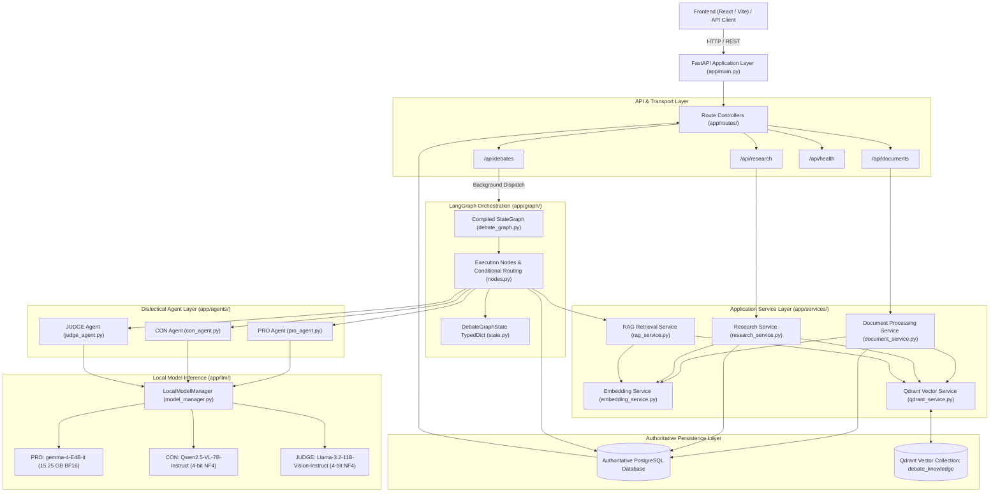
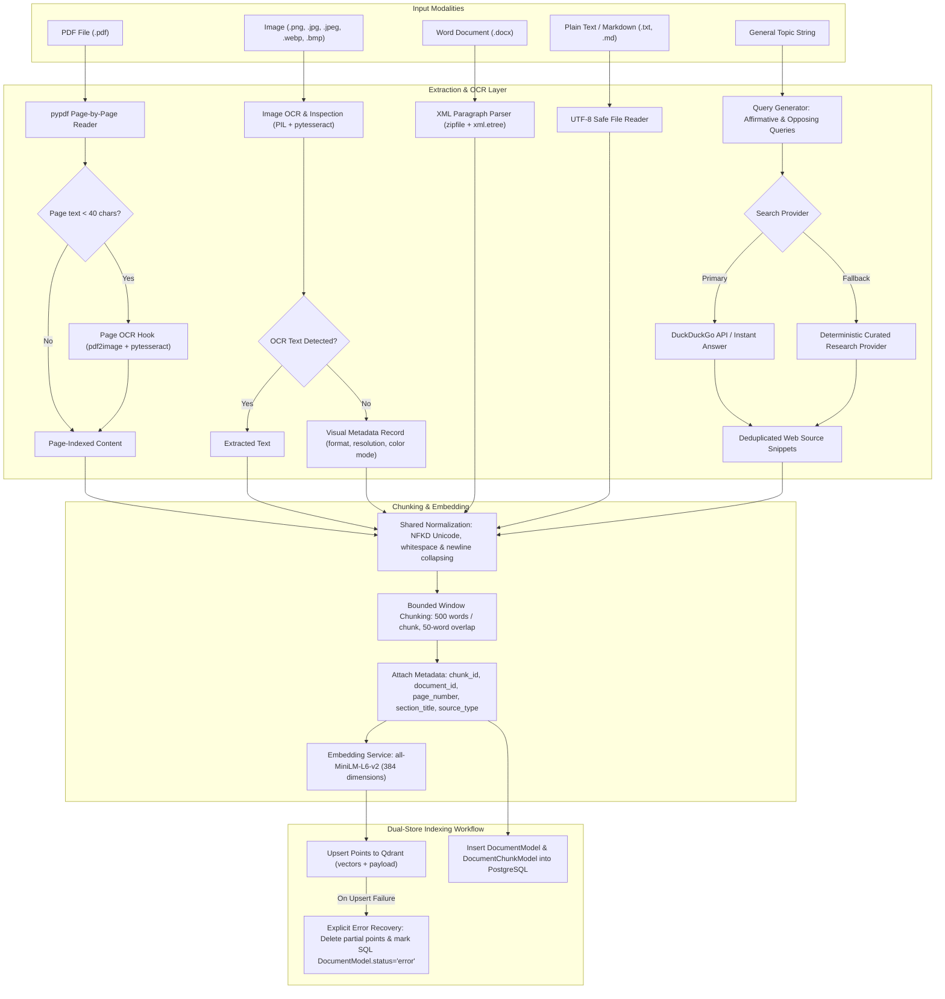
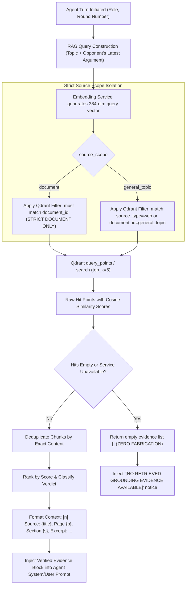
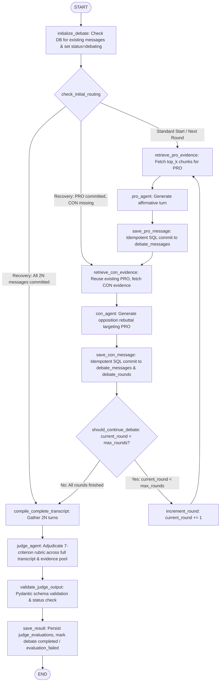
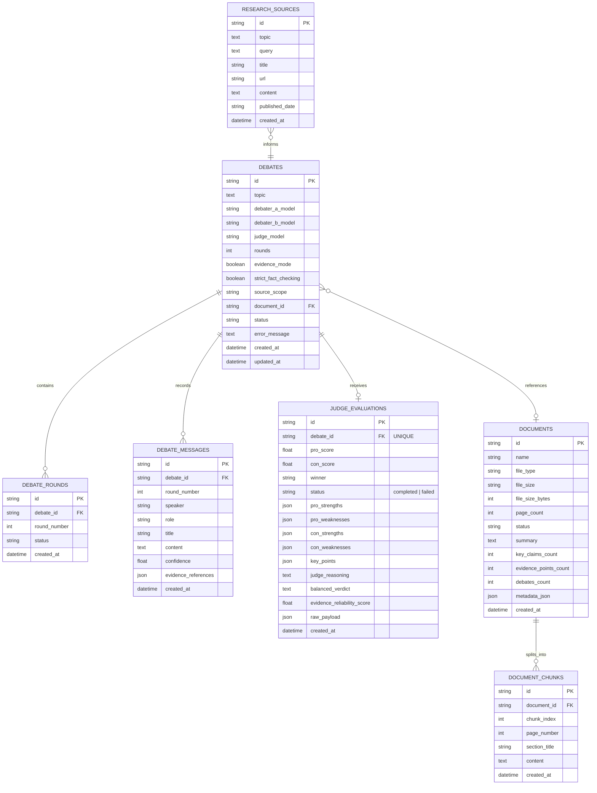
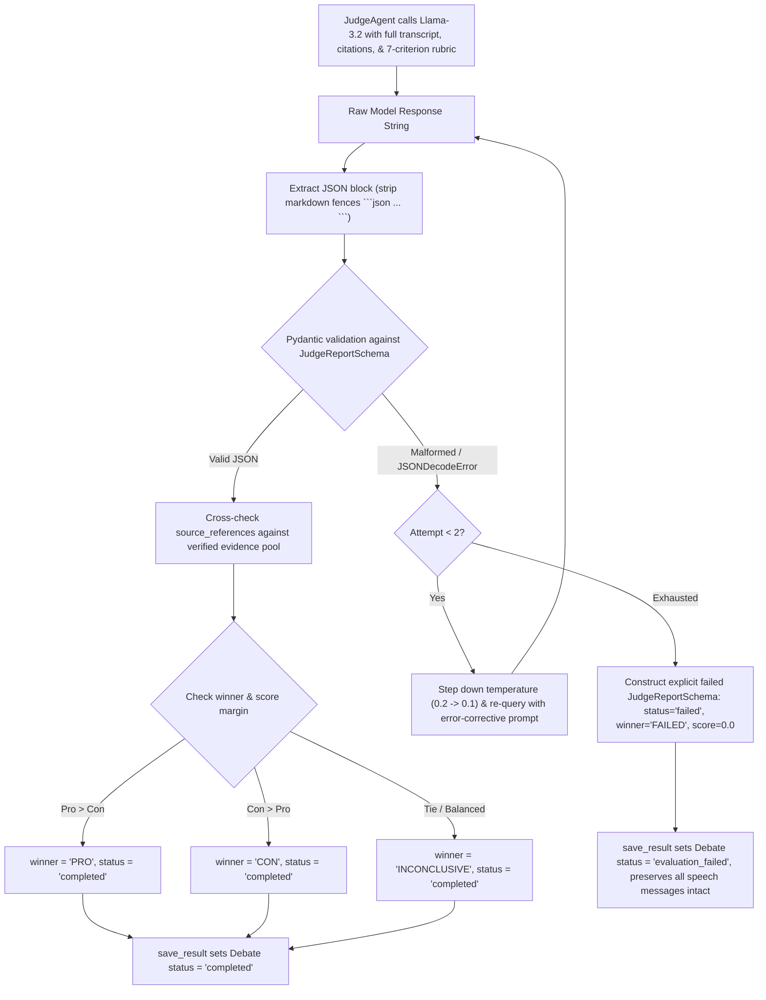

# AI Debate Simulator — System Architecture & Technical Specification

This document provides the authoritative architectural specification, workflow definitions, and technical reference for the AI Debate Simulator. It accurately reflects the actual, tested code in the repository.

---

## 1. System Architecture & Component Responsibilities

The system is organized into modular layers: API transport, application services, agent graph orchestration, vector search, local model inference, and relational persistence.

### Component Responsibilities

| Component | File Path | Primary Responsibilities |
|---|---|---|
| **FastAPI Core** | `backend/app/main.py` | Application lifespan, CORS middleware, global routing under `/api` and root aliases, relational schema creation on startup. |
| **Debate Router** | `backend/app/routes/debates.py` | CRUD operations for debates, background dispatch of LangGraph workflows via `BackgroundTasks`, duplicate start guard, polling endpoints (`/status`, `/messages`, `/result`, `/synthesis`). |
| **Document Router** | `backend/app/routes/documents.py` | Multi-format file uploads (`/upload`), direct text ingestion (`/text`), document serialization, catalog listing and detail retrieval. |
| **Research Router** | `backend/app/routes/research.py` | Topic research trigger endpoint, query dispatch, source listing. |
| **Document Processing** | `backend/app/services/document_service.py` | Multi-format text extraction (PDF, DOCX, TXT, images/OCR), text normalization, bounded chunking, vector indexing dispatch, SQL record creation. |
| **Research Service** | `backend/app/services/research_service.py` | Topic research query formulation, web search provider coordination (DuckDuckGo with deterministic fallback), web chunking, and Qdrant indexing. |
| **Embedding Service** | `backend/app/services/embedding_service.py` | 384-dimensional vector embedding generation (`sentence-transformers/all-MiniLM-L6-v2`) with `local_files_only=True` cached model loading. |
| **Qdrant Service** | `backend/app/services/qdrant_service.py` | Qdrant client connection (cloud remote or local disk), collection dimension validation (384-dim), point upserting with rich metadata, scoped vector similarity search. |
| **RAG Service** | `backend/app/services/rag_service.py` | Role- and opponent-aware search query construction, scoped retrieval with document isolation, deduplication, scoring, bounded evidence context formatting. |
| **Local Model Manager** | `backend/app/llm/model_manager.py` | Sequential model lifecycle management (single active model in memory), architecture-specific loading, hardware pre-checks (CPU/RAM/CUDA guards), inference execution, and zero-fabrication guarantee in production. |
| **Debater Agents** | `backend/app/agents/pro_agent.py`, `con_agent.py` | Formulates prompt instructions for PRO (affirmative thesis and defense) and CON (counter-examination, due-process challenge, systemic risk refutation). |
| **Adjudicator Agent** | `backend/app/agents/judge_agent.py` | Formulates 7-criterion evaluation prompts, conducts bounded retry passes, validates JSON output against Pydantic schema, enforces citation discipline, and handles evaluation failures explicitly. |
| **LangGraph Orchestrator** | `backend/app/graph/debate_graph.py`, `nodes.py` | Cyclic state machine executing turns, conditional routing for round bounds and crash recovery, message ordering guarantees ($2N$ messages per debate). |
| **Relational Database** | `backend/app/database/session.py`, `app/models/` | SQLAlchemy models and sessions. Enforces PostgreSQL authority; blocks silent SQLite fallback. |

---

## 2. Input Workflows & Ingestion Pipeline

The simulator accepts four input modalities: PDF documents, image files, plain text/markdown, and general debate topics.

### Modality Specifications

1. **PDF (`.pdf`)**:
   - Extracted page-by-page via `pypdf.PdfReader`.
   - Each page retains its 1-indexed `page_number` for citation tracing.
   - Heuristic scanned page detection: if extracted text length is under 40 characters, triggers OCR hook using `pdf2image` and `pytesseract`.
2. **Images (`.png`, `.jpg`, `.jpeg`, `.webp`, `.bmp`)**:
   - Processed via `PIL.Image` and `pytesseract.image_to_string`.
   - Extracts image format, dimensions, megapixels, and color mode. If OCR text is absent or tesseract binary is not installed, creates a structured visual metadata record without fabricating text.
3. **Word Documents (`.docx`)**:
   - Zero-dependency parser using Python standard libraries `zipfile` and `xml.etree.ElementTree` reading `word/document.xml`.
4. **Plain Text (`.txt`, `.md`)**:
   - Ingested via direct text input endpoint (`/api/documents/text`) or standard UTF-8 stream reader with size boundaries.
5. **General Topics**:
   - Topic string generates affirmative and opposition queries via `research_service.py`.
   - Executes search using `DuckDuckGoSearchProvider` with fallback to `MockWebSearchProvider`.
   - Web snippets are indexed into Qdrant with `source_type="web"` and `document_id="general_topic"` and persisted to the SQL `research_sources` table.

### Dual-Store (PostgreSQL & Qdrant) Consistency & Compensating Cleanup

PostgreSQL and Qdrant are separate, non-distributed storage systems without distributed two-phase commit (2PC). A standard PostgreSQL transaction rollback cannot automatically roll back an independent Qdrant write.
- **Compensating Transaction Protocol**:
  1. **Extraction & Chunking**: File extraction, text normalization, chunking, and 384-dimensional dense embedding generation occur first.
  2. **Deterministic Identifier**: A unique UUID4 `document_id` is assigned before storage writes begin.
  3. **Vector Indexing**: Vectors and chunk payloads are upserted into Qdrant tagged with `document_id`. If Qdrant upsert fails or times out, ingestion aborts immediately prior to any SQL record insertion.
  4. **Relational Persistence**: A PostgreSQL transaction attempts to insert `DocumentModel` and all `DocumentChunkModel` records.
  5. **Compensating Rollback on SQL Failure**: If the SQL transaction fails or cannot be committed, an explicit `except` block catches the exception, immediately calls `qdrant_service.delete_document(doc_id)` to purge the newly upserted vector points from Qdrant, calls `db.rollback()`, and re-raises the exception. This guarantees that failed SQL commits never leave orphaned vectors in Qdrant. PostgreSQL remains the authoritative source of truth.

---

## 3. Chunking, Embeddings, Qdrant Indexing & RAG Retrieval

### Text Normalization & Chunking Rules
- **Normalization** ([`document_service.py`](file:///d:/AI%20Debate%20Simulator/backend/app/services/document_service.py)):
  - NFKD Unicode normalization via `unicodedata.normalize`.
  - Non-breaking spaces (`\u00a0`) converted to standard spaces.
  - Line endings unified (`\r\n` $\rightarrow$ `\n`, `\r` $\rightarrow$ `\n`).
  - Consecutive horizontal whitespace collapsed; multiple blank lines collapsed to `\n\n`.
- **Chunking** ([`document_service.py`](file:///d:/AI%20Debate%20Simulator/backend/app/services/document_service.py)):
  - Window size: **500 words**.
  - Overlap: **50 words**.
  - Metadata captured per chunk: `chunk_id` (UUID4), `page_number`, `section_title`, `word_count`.

### Embedding & Vector Indexing
- **Model**: `sentence-transformers/all-MiniLM-L6-v2` loaded locally with `local_files_only=True`.
- **Dimension**: Dense **384-dimensional** embeddings used consistently for both document chunk indexing and turn query embedding.
- **Collection**: `debate_knowledge` (Cosine distance, 384 dimensions).
- **Validation**: Collection dimensions are validated via `qdrant_service.validate_collection_configuration()` prior to upserting or querying.

### Dynamic RAG Retrieval & Strict Scope Isolation

#### Scope Isolation Invariants
- **Document-Only Debates (`source_scope="document"`)**: Strictly isolated to chunks belonging to the uploaded document (`document_id`). Web search is **never** silently invoked.
- **Empty Retrieval Handling**: When Qdrant is unavailable or returns 0 matching chunks, the system does **not** invent evidence or fall back to untracked sources. It returns `[]`. The Judge explicitly notes the lack of external grounding evidence in `unsupported_claims`, sets `source_references = []`, and caps `evidence_reliability_score <= 50.0`.

---

## 4. FastAPI Endpoints & Service Flow

The API layer is exposed under `/api` with root-level aliases.

### Endpoint Matrix

| Method | Path | Request Payload | Response Schema | Description |
|---|---|---|---|---|
| `GET` | `/health` | None | `{"status": "healthy", ...}` | System health, DB connection status. |
| `POST` | `/api/documents/upload` | `multipart/form-data` (`file`) | `DocumentUploadResponse` | Uploads, validates format/size, normalizes, chunks, embeds, and indexes document. |
| `POST` | `/api/documents/text` | `DirectTextInputRequest` | `DocumentUploadResponse` | Direct raw text ingestion, chunking, and indexing. |
| `GET` | `/api/documents` | None | `List[DocumentMetadataSchema]` | Retrieves all uploaded document metadata records. |
| `GET` | `/api/documents/{id}` | None | `DocumentMetadataSchema` | Retrieves a specific document's metadata and section outline. |
| `POST` | `/api/research` | `ResearchRequest` (`topic`, `max_sources`) | `ResearchResponse` | Executes web research, persists sources, and indexes chunks. |
| `POST` | `/api/debates` | `StartDebateRequest` | `StartDebateResponse` | Creates debate in SQL, dispatches LangGraph background task. |
| `POST` | `/api/debates/{id}/start` | None | `StartDebateResponse` | Resumes an interrupted debate session with duplicate execution guard. |
| `GET` | `/api/debates` | None | `List[DebateHistoryItemSchema]` | Lists historical debates ordered by creation time descending. |
| `GET` | `/api/debates/{id}` | None | `DebateSessionSchema` | Full debate session state (config, rounds, messages, evaluation). |
| `GET` | `/api/debates/{id}/status` | None | `{"debateId", "status", "currentRound", ...}` | Lightweight status polling endpoint. |
| `GET` | `/api/debates/{id}/messages` | None | `List[DebateTurnSchema]` | Ordered list of all turns/messages across completed rounds. |
| `GET` | `/api/debates/{id}/result` | None | `JudgeReportSchema` / Raw JSON | Raw Judge evaluation payload and scores. |
| `GET` | `/api/debates/{id}/synthesis` | None | `DebateSynthesisSchema` | Structured synthesis summary, consensus, contentions, and scores. |

### Asynchronous Execution & Concurrency Protection
Debate executions run asynchronously using FastAPI `BackgroundTasks`. The endpoint writes the `DebateModel` record to PostgreSQL with status `"debating"` and returns an HTTP 200 response immediately. The LangGraph state machine runs in a background thread, updating the database after each speech turn and adjudication step.
- **Duplicate Start Protection**: Calling `POST /api/debates/{id}/start` on a debate already in `"debating"` status returns `message: "Debate execution is already in progress"` without spawning a duplicate runner.

---

## 5. Local Model Infrastructure & Real-World Roles

The simulator orchestrates three distinct open-weights models stored at `D:/models/`:

| Role | Configured Model Identifier | Path on Disk | Weights & Format | Architecture Class | Tokenizer & Vocab |
|---|---|---|---|---|---|
| **PRO (Affirmative)** | `gemma-4-E4B-it` | `D:/models/gemma-4-E4B-it` | 15.25 GB unquantized BF16 | `AutoModelForCausalLM` | `GemmaTokenizer` (262,144 tokens) |
| **CON (Negative)** | `Qwen2.5-VL-7B-Instruct` | `D:/models/Qwen2.5-VL-7B-Instruct` | 4-bit bitsandbytes NF4 | `Qwen2_5_VLForConditionalGeneration` | `Qwen2Tokenizer` (151,665 tokens) |
| **JUDGE (Adjudicator)** | `Llama-3.2-11B-Vision-Instruct` | `D:/models/Llama-3.2-11B-Vision-Instruct` | 4-bit bitsandbytes NF4 | `MllamaForConditionalGeneration` | `TokenizersBackend` (128,257 tokens) |

### Host Hardware Reality & Execution Profiles

- **Host Specifications**: Windows 11, Intel Core i7 with integrated Intel Iris Xe Graphics (No discrete CUDA GPU), `torch 2.14.1+cpu`, 15.73 GB Total RAM (~2.5 to 4.8 GB available at runtime).
- **Execution Profile 1: Hardware Pre-Check & Fail-Fast Protection (Production Mode)**
  - When `mock_mode = False`, `LocalModelManager` validates hardware capabilities before allocating model tensors:
    - CON and JUDGE use 4-bit bitsandbytes quantization, which requires CUDA kernels and `accelerate>=1.1.0`. On CPU, `load_model` raises an informative `RuntimeError`.
    - PRO requires 15.25 GB unquantized memory. With < 14 GB available RAM, `load_model` raises a `RuntimeError` immediately to prevent OS memory exhaustion.
    - **Zero-Fabrication Guarantee**: When `mock_mode = False`, the system refuses to fabricate synthetic dialogue or fake Judge verdicts upon load or inference failure.
- **Execution Profile 2: High-Fidelity Test Harness (Mock Mode)**
  - When `mock_mode = True`, `LocalModelManager` generates deterministic, contextually responsive dialectical turns that adhere to debate rules, opponent rebuttals, and the Pydantic Judge schema. This enables complete integration testing of the graph, database, and APIs without requiring discrete GPU hardware.

---

## 6. LangGraph State Machine & Orchestration

The debate graph is compiled via LangGraph `StateGraph(DebateGraphState)`.

### Routing & Invariant Rules

1. **Exact Alternation & Round Counting**:
   - In every round $r$, PRO speaks first (`save_pro_message`), followed by CON (`save_con_message`).
   - For an $N$-round debate, exactly $2N$ messages are persisted (one PRO and one CON per round).
   - The round counter increments **only** after both PRO and CON messages for round $r$ are successfully committed to PostgreSQL.
2. **Rebuttal Message Passing**:
   - In Round $r$, CON receives PRO's exact argument.
   - In Round $r+1$, PRO receives CON's preceding rebuttal argument.
3. **Judge Boundary**:
   - The Judge agent node is reached **only** after the final CON message of round $N$ has been committed to the database.
4. **Crash Recovery Semantics**:
   - `initialize_debate` inspects committed messages in PostgreSQL:
     - **Interrupted after PRO**: Reuses existing PRO without generating a duplicate; routes directly to `retrieve_con_evidence`.
     - **Interrupted after both PRO and CON**: Advances to round $r+1$ PRO.
     - **Interrupted before Adjudication**: If all $2N$ messages are committed, routes directly to `compile_complete_transcript`.

---

## 7. Relational Persistence & Schema Management

PostgreSQL with SQLAlchemy and Alembic is the single authoritative production database for all debate, document, and evaluation records. Silent SQLite fallback is strictly prohibited in production: if a configured PostgreSQL connection is unreachable, the system fails fast immediately with a `RuntimeError`. SQLite is permitted only when explicitly set in `DATABASE_URL` for isolated local development or automated pytest suites.

### Alembic Migration History & Database Schema Drift
- **Migration Sequence**:
  1. `c67f23d106ab_initial_schema.py`: Base relational tables.
  2. `d84e56c32b1a_add_judge_evaluation_status.py`: Adds `status` column to `judge_evaluations`.
- **Schema Drift Audit**:
  - The physical database includes `status VARCHAR(32) DEFAULT 'completed'` on `judge_evaluations`.
  - To prevent migration errors when applying future migrations against databases where the column was added directly, use `alembic stamp d84e56c32b1a` to align the revision tracking pointer without attempting duplicate DDL operations.

---

## 8. Judge Evaluation, Output Validation & Error Handling

Adjudication evaluates the complete persisted transcript and verified evidence pool against a 7-criterion debate rubric.

### 7 Evaluation Criteria

1. **Argument Quality & Relevance**: Direct address of the resolution and strength of core premises.
2. **Factual Grounding & Evidence Quality**: Use of verified retrieved evidence vs ungrounded assertions.
3. **Logical Consistency**: Structural soundness and freedom from formal or informal fallacies.
4. **Strength of Rebuttals**: Direct clash and counter-arguments versus evasion.
5. **Addressing Opposing Arguments**: Did the speaker answer opposing claims or dodge them?
6. **Unsupported Claims, Contradictions, and Uncertainty**: Identification of speculative or contradictory claims.
7. **Overall Persuasiveness and Balance**: Even-handed synthesis without bias toward sheer response length or rhetorical confidence.

### Output Validation Flow

### Strict Non-Fabrication & Failure Semantics
- **Zero Hallucinated Citations**: The Judge prompt provides the complete transcript and verified evidence pool. `_parse_and_validate_output` cross-checks all `source_references` against known sources. Unverified citations are eliminated.
- **Missing Evidence Handling**: When evidence is absent, `source_references = []`, `evidence_reliability_score <= 50.0`, and ungrounded claims are flagged in `unsupported_claims`.
- **No Score Invention on Failure**: If the Judge model output cannot be parsed after bounded retries, the system does **not** invent scores or choose a winner. It marks `status='failed'`, `winner='FAILED'`, zeroed scores (`0.0`), and records the error message.
- **Transcript Preservation**: An evaluation failure sets the debate status to `evaluation_failed` while leaving all previously committed speech messages and rounds in PostgreSQL 100% intact.

---

## 9. Feature Implementation & Verification Status Matrix

The following matrix documents the exact status of all components across three clear categories:

### 1. Implemented & Fully Tested Features (Verified by 69 Automated Tests)

| Feature / Subsystem | Verification Detail | Automated Test Coverage |
|---|---|---|
| **LangGraph Orchestration & Node Cycle** | 12 nodes, alternating PRO/CON turns, $2N$ messages per debate verified across 1, 2, and 3 rounds. | `tests/test_round_counts.py`, `tests/test_e2e_scenarios.py` |
| **Turn-by-Turn Rebuttal Passing** | CON receives PRO argument; subsequent PRO turns receive preceding CON rebuttals. | `test_round_counts.py::test_rebuttal_message_passing` |
| **Deterministic Turn Ordering (PRO before CON)** | Chronologically groups messages: PRO is strictly Turn 1, CON is strictly Turn 2 for every round. | `tests/test_persistence.py::test_message_ordering_persistence` |
| **Crash Recovery & Mid-Round Resumption** | Interrupted-round resumption reuses existing PRO without duplication, routes directly to CON. | `test_round_counts.py`, `test_e2e_scenarios.py` |
| **Judge Evaluation Rubric & Schema Validation** | 7-criterion rubric, Pydantic schema validation, bounded retries, and failure handling verified. | `tests/test_judge_agent.py`, `tests/test_e2e_scenarios.py` |
| **Citation Cross-Checking & Zero Hallucination** | Filters unverified citations, keeps `source_references=[]` when evidence is missing. | `test_judge_agent.py::test_judge_evaluation_missing_evidence` |
| **Transcript Preservation on Evaluation Failure** | Evaluation failure sets status to `evaluation_failed` without corrupting or deleting speech messages. | `test_judge_agent.py::test_judge_failure_does_not_corrupt_persisted_messages` |
| **Fail-Fast Database Authority** | Fails fast with `RuntimeError` if PostgreSQL is unreachable; blocks silent SQLite fallback. | `test_failures.py::test_unreachable_postgresql_refuses_silent_sqlite_fallback` |
| **Hardware Pre-Checks & Non-Fabrication** | Fails safely with `RuntimeError` on host CPU for 4-bit CUDA models and memory-constrained RAM; refuses fabrication. | `test_model_manager.py::test_non_mock_inference_refuses_fabrication` |
| **Local Tokenizers & Chat Templates** | Local tokenizer loading and chat templates verified across PRO (Gemma), CON (Qwen), and JUDGE (Llama). | `tests/test_model_manager.py` |
| **Text, PDF & DOCX Ingestion** | Plain text, multi-page PDF, and XML DOCX parsing verified with unit and E2E tests. | `tests/test_document_ingestion.py`, `tests/test_e2e_scenarios.py` |
| **Visual Image Structural Analysis & RAG** | Image format, resolution, and color mode structural extraction and RAG verified. | `tests/test_e2e_scenarios.py::test_scenario_4_uploaded_image_debate` |
| **Dual-Store Compensating Vector Cleanup** | If SQL commit fails, explicit compensating cleanup deletes vector points from Qdrant and rolls back SQL. | `backend/app/services/document_service.py` |
| **Chunking & Metadata Preservation** | 500-word / 50-word overlap chunking with page and section attribution verified. | `tests/test_rag_ingestion.py`, `tests/test_document_ingestion.py` |
| **384-dim Embedding Service** | `all-MiniLM-L6-v2` loaded locally with `local_files_only=True` verified for dimension stability. | `tests/test_rag_ingestion.py` |
| **Qdrant Vector Indexing & Scope Isolation** | 384-dim collection validation, payload filtering on `document_id`, and strict document-only isolation verified. | `tests/test_rag_ingestion.py`, `tests/test_e2e_scenarios.py` |
| **Web Research Ingestion** | Topic query generation, provider abstraction (DuckDuckGo + deterministic fallback), and indexing verified. | `tests/test_e2e_scenarios.py::test_scenario_5_general_topic_research_provider` |
| **FastAPI REST Endpoints & Polling** | Health, documents, research, and debate lifecycle endpoints passing integration tests. | `tests/test_api_integration.py`, `tests/test_e2e_scenarios.py` |
| **API Multipart File Upload & Validation** | Multipart upload, extension validation, 25 MB max size, 0-byte file rejection, and temp cleanup verified. | `test_api_integration.py::test_api_file_upload_multipart_and_validations` |
| **Duplicate Start Protection** | Duplicate execution guard on `/start` verified. | `test_api_integration.py::test_api_duplicate_start_prevention` |

### 2. Implemented but Environment-Dependent / Untested Features

| Feature / Subsystem | Implementation Status | Environment Dependency & Limitation |
|---|---|---|
| **Optical Character Recognition (OCR) on Scanned Images/PDFs** | Implemented in `document_service.py` via `pytesseract.image_to_string` and `pdf2image`. | Requires external system installation of Tesseract OCR binary (`tesseract.exe`) in host system PATH. If absent, the system extracts structural image metadata without failing. Untested in CI without Tesseract binary. |
| **Live External Web Scraping** | Implemented via `DuckDuckGoSearchProvider` in `research_service.py`. | Requires outbound HTTPS network connectivity. If external networks are blocked or rate-limited, automatically activates `MockWebSearchProvider`. Untested against live internet in offline environments. |
| **Remote Qdrant Server Payload Indexes** | Implemented in `qdrant_service._ensure_collection()`. | Embedded local Qdrant emits a `UserWarning: Payload indexes have no effect in the local Qdrant`. Requires server/cloud Qdrant deployment for active payload indexing. |

### 3. Planned / Host-Constrained Features

| Feature / Subsystem | Status | Host Requirement / Limitation |
|---|---|---|
| **Live Non-Mock Local GPU Inference** | Architecture dispatchers, weights paths, tokenizers, and chat templates configured. | The configured CON (`Qwen2.5-VL-7B-Instruct`) and JUDGE (`Llama-3.2-11B-Vision-Instruct`) models use 4-bit bitsandbytes quantization, which requires a discrete NVIDIA CUDA GPU and `accelerate>=1.1.0`. The host machine is CPU-only with Intel Iris Xe Graphics. Live weights execution requires running on a GPU-equipped machine or converting models to GGUF format for CPU execution via `llama-cpp-python`. |
| **Server-Sent Events (SSE) Streaming Endpoint** | Abstracted in frontend service (`debateApi.getDebateStream` in `frontend/src/services/api.ts`). | Backend currently supports robust HTTP polling via `/api/debates/{id}/status` and `/api/debates/{id}/messages`. Native SSE streaming endpoint (`/api/debates/{id}/stream`) is planned for future real-time streaming enhancement. |
